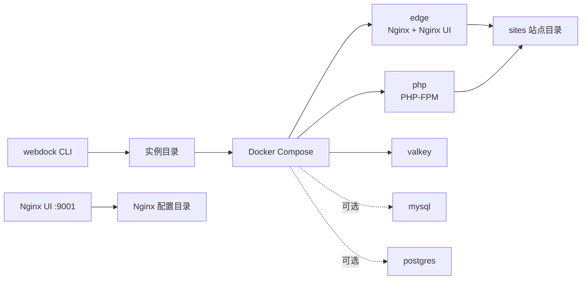

# Webdock

Webdock 是一个面向单机 Linux 的轻量 Docker Compose 容器栈管理工具，用固定、可迁移的实例目录替代传统 LNMP 的手工安装。它负责生成配置、管理容器生命周期、检查运行状态，并保留 Nginx UI 作为网站和 Nginx 配置的管理入口。

当前版本定位为 pre-1.0，适合单机、小规模部署。项目优先使用官方镜像；只有需要组合 Nginx 模块、Nginx UI 和 PHP 扩展时才维护自定义镜像。

## 组件

| 服务 | 默认版本 | 说明 |
| --- | --- | --- |
| `edge` | Nginx 1.26.3 + Nginx UI 2.9.1 | host 网络，提供 HTTP/HTTPS、Nginx 配置管理和常用动态模块 |
| `php` | PHP 8.4 FPM | 预装 Composer 和常用扩展，监听 `127.0.0.1:9000` |
| `valkey` | Valkey 8 | AOF 持久化、ACL 认证、可选的 Docker bridge 网关监听 |
| `mysql` | MySQL 8.4 | 可选服务，使用 Compose `mysql` profile |
| `postgres` | PostgreSQL 18 | 可选服务，使用 Compose `postgres` profile |

镜像标签：

```text
hicasper/webdock-edge:latest
hicasper/webdock-php:8.4
valkey/valkey:8-trixie
mysql:8.4
postgres:18
```

## 运行架构



- Nginx 与 PHP-FPM 使用 host 网络，通过 `127.0.0.1:9000` 通信。
- Nginx UI 只监听 `127.0.0.1:9001`，通过 SSH 隧道访问。
- 数据库启用时只监听本机回环地址。
- Valkey 默认只监听 `127.0.0.1`，并可为已配置的 Docker bridge 网络绑定对应网关地址。

## 环境要求

- Linux
- rootful Docker Engine
- Docker Compose v2
- amd64 或 arm64
- 建议至少 1 vCPU、512 MB 内存；所选数据库的内存需求另计

第一版不支持 Docker Desktop、rootless Docker、Podman 或 SELinux 强制模式。启用 host 网络前，应停止宿主机上占用 80/443、9000、9001、6379 或数据库端口的旧服务。

## 安装 CLI

从源码构建并安装：

```bash
go build -trimpath -o bin/webdock ./cmd/webdock
sudo install -m 0755 bin/webdock /usr/local/bin/webdock
```

也可以通过 Makefile 构建：

```bash
make build
```

## 快速开始

```bash
# 创建一个不使用数据库的实例
webdock init /srv/webdock --db none

cd /srv/webdock
webdock doctor
webdock up
webdock status
```

首次启动会在实例目录生成随机凭据、默认证书和 Compose 配置。`webdock.env` 保存数据库与 Valkey 凭据以及 Nginx UI 密钥，权限必须保持为 `0600`。

访问 Nginx UI：

```bash
webdock ui
ssh -L 9001:127.0.0.1:9001 <user>@<server>
```

然后在浏览器打开 <http://127.0.0.1:9001>。Nginx UI 负责管理 `/etc/nginx` 对应的实例配置；Webdock 只负责提供目录、挂载和进程守护，不接管 Nginx UI 的配置编辑逻辑。

## 命令

```text
webdock [-C DIR] <command> [options]

init [DIR] [--db none|mysql|postgres]  创建实例
up [--pull]                            启动或更新容器栈
down                                   停止并移除容器栈
restart                                重启容器栈
status                                 查看容器状态
logs [service]                         跟随服务日志
doctor                                 执行只读检查
shell <service>                        进入服务容器
db use none|mysql|postgres             切换数据库引擎
backup [--with-sites] [--with-logs]    创建离线备份
restore [--force] <archive>            恢复离线备份
ui                                     显示 Nginx UI 地址和隧道命令
```

常用示例：

```bash
webdock up --pull
webdock logs edge
webdock shell php
webdock -C /srv/webdock status
```

`up` 会先检查端口冲突、渲染 Valkey 监听地址、启动所选 Compose profile，并等待健康检查及服务探测通过。

## 实例目录

```text
/srv/webdock/
├── webdock.env              # 0600，凭据与运行参数
├── compose.yaml             # 由 webdock 维护
├── config/
│   ├── nginx/               # Nginx 与 Nginx UI 管理的配置
│   ├── php/                 # PHP 实例配置
│   ├── valkey/              # 运行时生成的 Valkey 配置
│   └── mysql/               # MySQL 配置
├── sites/                   # 站点源码，挂载到 /var/www
├── data/
│   ├── nginx-ui/            # Nginx UI 数据库和应用数据
│   ├── valkey/              # Valkey AOF
│   ├── mysql/               # MySQL 数据
│   └── postgres/            # PostgreSQL 数据
├── logs/nginx/              # Nginx 文件日志
└── backups/                 # 默认备份输出目录
```

`config/`、`data/` 和 `webdock.env` 是实例的核心状态。`sites/` 通常由业务仓库或部署流程管理，默认不进入备份。

## Nginx 与模块

实例中的 Nginx 配置遵循 Debian 风格目录：

```text
config/nginx/
├── nginx.conf
├── conf.d/
├── modules-available/
├── modules-enabled/
├── sites-available/
├── sites-enabled/
├── snippets/
├── ssl/
├── streams-available/
└── streams-enabled/
```

默认站点返回 `444`。默认配置启用 GeoIP2、Stream 和 Stream-GeoIP2，其他动态模块已安装但通过软链接启用状态控制。可用模块包括 Brotli、cache purge、DAV Ext、Echo、Headers More、Image Filter、Lua、Substitution、Upstream Fair、XSLT 和 RTMP；NDK 作为依赖安装。需要模块时，在 `modules-enabled/` 中创建指向 `modules-available/` 的软链接，再由 Nginx UI 或 `nginx -s reload` 应用。

全局 keepalive 为 100 秒；TLS 配置禁用 TLS 1.0、保留 TLS 1.1，并启用 TLS 1.2/1.3。对外提供公共服务时，建议在具体站点中按客户端兼容性收紧 TLS 1.1。

## PHP

PHP 8.4 镜像预装以下扩展：

```text
bcmath exif gd intl mysqli pdo_mysql pdo_pgsql pgsql redis sockets zip
```

Composer 已安装。实例级 `config/php/php.ini` 默认关闭错误回显、开启错误日志，并设置常用的上传与执行限制。应用专属设置可直接维护该实例文件；如需拆成多个 `conf.d` 文件，应同步调整 Compose 挂载，而不是反复修改镜像。

## 数据库

数据库为可选组件。创建实例时可以选择，也可以稍后切换：

```bash
webdock db use mysql
webdock db use postgres
webdock db use none
```

切换数据库只停止旧引擎并启动目标引擎，不会清空或迁移已有数据。旧数据库的数据目录会保留；切回后可继续使用。MySQL X Protocol 被禁用，MySQL 与 PostgreSQL 都只监听 `127.0.0.1`。

## Docker 容器访问 Valkey

默认探测名为 `bridge` 的 Docker 网络。需要允许其他 bridge 网络中的容器访问 Valkey 时，在 `webdock.env` 中配置：

```text
VALKEY_BRIDGE_NETWORKS=bridge,myproject_default
```

执行 `webdock up` 或 `webdock restart` 后，Webdock 会读取这些网络的实际网关并写入 Valkey `bind` 配置。只有确认是本机接口地址的 IPv4 网关才会被加入；网络不存在或网关无效时会警告并跳过，不会退化为监听 `0.0.0.0`。

Valkey 使用名为 `webdock` 的 ACL 用户和 `webdock.env` 中的密码，策略为 `allkeys-lru`，最大内存默认 `128mb`，AOF 使用 `everysec`。

## 日志

- Nginx 文件日志写入 `logs/nginx/`，目录整体挂载到容器 `/var/log/nginx`；`access.log` 已预留，业务配置可直接启用 access log。
- PHP-FPM、Valkey、MySQL、PostgreSQL 和 Nginx UI 默认输出到 stdout/stderr。
- Docker 使用 json-file 日志驱动，单文件限制 10 MB，最多保留 2 个文件。日志仍位于宿主机 Docker 数据目录，不会进入实例的 `data/`。

查看日志：

```bash
webdock logs
webdock logs edge
```

## 备份与恢复

```bash
webdock backup
webdock backup --with-sites --with-logs
webdock restore --force /path/to/webdock-20261022-120000.tar.gz
```

备份默认包含 `webdock.env`、`config/` 和 `data/`，默认排除 `sites/` 与 `logs/`。备份期间会停止整个容器栈，完成后恢复原来的运行状态。

恢复会先解压到临时目录，校验实例布局、Compose 配置和 `webdock.env` 权限，通过后才替换现有数据；失败时回滚。若 Webdock 固定名称的容器处于运行、暂停或重启状态，恢复会先通过 Compose 停止并确认停止成功，否则拒绝继续。归档拒绝绝对路径、目录穿越、重复路径和逃逸实例目录的软链接。

数据库和 Valkey 可能把文件所有权改为容器内 UID，Nginx UI 也会写入自己的数据。建议使用 root 或对实例 `config/`、`data/` 有完整读写权限的用户执行备份与恢复。

## 安全说明

- `webdock.env` 必须为普通文件且权限为 `0600`；不要把该文件提交到版本库。
- Nginx UI、PHP-FPM、数据库和 Valkey 不监听公网地址；Nginx UI 应通过 SSH 隧道访问。
- Nginx 容器使用 host 网络，端口暴露范围由实例中的 Nginx 配置决定。
- 备份归档包含数据库凭据和全部服务数据，应按敏感文件保管。
- `restore --force` 会替换实例数据，执行前应确认归档来源。

## 开发与验证

```bash
gofmt -w cmd internal tests templates
go test ./...
go test -race ./...
go vet ./...
go build -trimpath -o bin/webdock ./cmd/webdock
staticcheck ./...
```

镜像本地构建：

```bash
docker build -t hicasper/webdock-edge:latest images/edge
docker build -t hicasper/webdock-php:8.4 images/php
```

多架构构建需要在支持 Buildx 和 QEMU 的环境中执行。GitHub Actions 工作流位于 `.github/workflows/ci.yml`，执行测试后在 Docker Hub 发布多架构镜像；GHCR 发布代码已保留但默认关闭。

更完整的架构边界、目录职责和修改检查清单见 [AGENTS.md](AGENTS.md)，版本变更与验证记录见 [CHANGELOG.md](CHANGELOG.md)。

## 参考项目

- [garylab/dnmp](https://github.com/garylab/dnmp)
- [hicasper/lnmp](https://github.com/hicasper/lnmp)
- [0xJacky/nginx-ui](https://github.com/0xJacky/nginx-ui)
